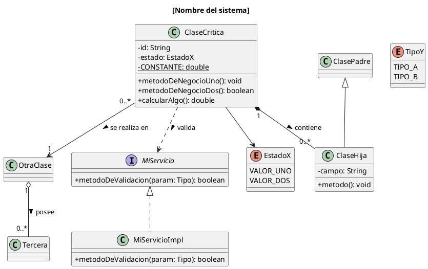

# Guía para resolver el examen parcial solo
## Diseño de Experimentos de Ingeniería de Software (SI732)

---

# PARTE 0: Cómo repartir el tiempo

Tienes 170 minutos. Reparto recomendado:

| Momento | Minutos | Qué haces |
|---|---|---|
| Lectura y análisis | 20 | Leer el caso y llenar la "tabla de reglas" |
| Pregunta 1 (UML) | 35 | Diagrama en PlantUML |
| Pregunta 2 (Tests) | 45 | Dominio + 4 pruebas |
| Pregunta 3 (Feature) | 25 | Gherkin |
| Pregunta 4 (Steps) | 30 | Step Definitions |
| Revisión y pegado al Word | 15 | Checklist final |

**Regla de oro:** no empieces a dibujar hasta terminar el paso 1 de la lectura. Los 20 minutos de análisis son los que hacen que las 4 preguntas salgan solas.

---

# PARTE 1: Análisis del enunciado (20 min)

## Paso 1.1 — Subraya los sustantivos

Lee el caso y subraya todo sustantivo que represente una "cosa" del negocio. En Tenis Champions salían: campeonato, categoría, jugador, grupo, partido, set, ranking, inscripción, pago, sorteo, cabeza de serie.

Luego descarta:
- Los que son solo un dato de otra cosa (DNI, nombre, fecha) → son **atributos**, no clases.
- Los que son del proceso de desarrollo, no del negocio (Scrum Master, Frontend, Backend) → **no van** en el diagrama de dominio.

## Paso 1.2 — Arma la tabla de reglas de negocio

Esta tabla es la pieza clave del examen. Busca en el enunciado las frases que digan: "no puede", "solo si", "debe", "únicamente", "salvo", "es obligatorio", "se calcula como".

Haz una tabla así en una hoja aparte:

| # | Regla (en palabras del enunciado) | Clase donde vive | Qué pasa si falla |
|---|---|---|---|
| 1 | Un jugador sin experiencia inicia en 5ta | Campeonato | Rechazar inscripción |
| 2 | No puede jugar categoría que ya campeonó | Campeonato | Rechazar inscripción |
| 3 | Jugador inhabilitado no compite | Campeonato | Rechazar inscripción |
| 4 | Dos cabezas de serie no van al mismo grupo | Campeonato | Sorteo inválido |
| 5 | Ranking = partidos ganados + games ganados | Jugador | Cálculo |

Con 5 o 6 reglas tienes material de sobra para las 4 preguntas.

## Paso 1.3 — Identifica la CLASE CRÍTICA

Es la clase donde se repite más veces la columna "Clase donde vive". Esa es la que concentra el business logic.

Reglas para elegirla bien:
- **NO** puede ser Usuario, Jugador, Cliente, Persona ni similares. El enunciado lo prohíbe expresamente.
- **NO** puede ser un CRUD (una clase que solo guarda y lee datos).
- **SÍ** debe ser la que toma decisiones: la que acepta o rechaza, la que calcula, la que cambia de estado.

Truco rápido: es casi siempre la clase que representa **la transacción o el proceso central**, no la persona ni el catálogo.

| Caso | Clase crítica correcta | Clase que NO debes elegir |
|---|---|---|
| Veterinaria | CitaMedica | Usuario, DuenoMascota |
| Exploración minera | ExploracionMinera | Terreno, Usuario |
| Tenis | Campeonato | Jugador |
| Mantenimiento minero | OrdenMantenimiento | Equipo, Tecnico |
| Banca | Prestamo o Transaccion | Cliente, Cuenta |
| Delivery | Pedido | Usuario, Restaurante |

## Paso 1.4 — Identifica el SERVICIO EXTERNO

Busca algo que el sistema necesita consultar pero que no controla: un pago, una certificación, un permiso, una notificación, una validación legal.

Eso será tu **interfaz** (`PagoService`, `PermisoService`, `NotificacionService`). Es importante por tres razones:
1. Te da la interfaz que la rúbrica pide en el UML.
2. Te da algo que mockear en las pruebas unitarias.
3. Te da una regla de negocio extra para probar.

Si el enunciado no tiene uno obvio, invéntalo con criterio: casi todo proceso tiene un pago, una notificación o una validación externa.

---

# PARTE 2: Pregunta 1 — UML Class Diagram (35 min)

## Qué pide la rúbrica para sacar el puntaje completo

1. Clases del dominio (no del equipo de desarrollo)
2. **Interfaces**
3. **Enumeraciones**
4. Atributos y métodos en cada clase
5. **Scope**: `-` private, `+` public, `#` protected
6. Relaciones con **multiplicidad**
7. Nomenclatura consistente (todo en español o todo en inglés, no mezclado)

Los puntos 2, 3 y 5 son los que casi todos olvidan. Ahí está tu ventaja.

## Paso 2.1 — Decide las enumeraciones

Busca en el enunciado los campos que tienen **valores fijos y limitados**. Esos son enums, no Strings.

Señales: "el estado puede ser X, Y o Z", "hay 5 categorías", "los tipos son A y B".

Siempre caen al menos dos:
- Un enum de **estado** del objeto principal (EN_CURSO/FINALIZADA, PENDIENTE/CONFIRMADA, PROGRAMADA/COMPLETADA)
- Un enum de **tipo o clasificación** (TipoPermiso, Categoria, TipoZona, Prioridad)

Truco avanzado que suma: si el enum tiene un **orden** (categorías de 1ra a 5ta, niveles de prioridad), dale un atributo numérico `nivel`. Así puedes comparar con `>=` en lugar de comparar texto, y eso convierte una regla difusa en código limpio.

## Paso 2.2 — Escribe la plantilla PlantUML



## Paso 2.3 — Elige bien el tipo de relación

| Símbolo | Nombre | Cuándo usarlo | Ejemplo |
|---|---|---|---|
| `*--` rombo relleno | Composición | La parte **no existe** sin el todo | Partido → Set |
| `o--` rombo vacío | Agregación | La parte **sí existe** sola | Grupo → Jugador |
| `-->` flecha simple | Asociación | Solo se conocen | Exploración → Terreno |
| `<\|--` triángulo lleno | Herencia | "es un" | Usuario ← MiembroEquipo |
| `<\|..` triángulo punteado | Realización | Implementa interfaz | PagoService ← PagoServiceImpl |
| `..>` punteada | Dependencia | La usa pero no la guarda | Campeonato ..> PagoService |

Pregunta de control para composición vs agregación: *"si borro el objeto grande, ¿el pequeño sigue teniendo sentido?"*. Si no → composición.

## Paso 2.4 — Multiplicidades

Siempre pon las dos puntas. Las más comunes:
- `"1" --> "0..*"` → uno tiene muchos, que pueden ser cero
- `"1" --> "1..*"` → uno tiene muchos, al menos uno
- `"0..*" --> "1"` → muchos pertenecen a uno
- `"1" --> "4"` → cantidad exacta (grupo de 4 jugadores)

---

# PARTE 3: Pregunta 2 — Unit & Integration Test (45 min)

## Paso 3.1 — Escribe primero el dominio

Antes de las pruebas, escribe la clase crítica con sus reglas. Estructura que siempre funciona: **las validaciones van en el constructor o en el método de negocio, y lanzan excepción**.

```java
class ClaseCritica {

    private static final double UMBRAL = 0.50;
    private EstadoX estado;

    public ClaseCritica(Dependencia dep, MiServicio servicio) {
        // Regla 1: [copia la frase del enunciado]
        if (!dep.cumpleCondicion()) {
            throw new IllegalStateException("Mensaje claro de por que se rechaza.");
        }
        // Regla 2: validacion con servicio externo
        if (!servicio.validar(dep)) {
            throw new IllegalArgumentException("Otro mensaje claro.");
        }
        this.estado = EstadoX.VALOR_UNO;
    }

    // Regla 3: calculo del negocio
    public double calcularAlgo() {
        // suma, promedio, conteo...
    }

    // Regla 4: decision basada en el calculo
    public boolean esValido() {
        return calcularAlgo() >= UMBRAL;
    }

    // Regla 5: cambio de estado con precondicion
    public void finalizar() {
        if (calcularAlgo() == 0) {
            throw new IllegalStateException("No se puede finalizar sin datos.");
        }
        this.estado = esValido() ? EstadoX.VALOR_UNO : EstadoX.VALOR_DOS;
    }
}
```

**Cuál excepción usar:**
- `IllegalStateException` → el objeto o el sistema no está en condición de hacerlo (concesión vencida, orden no programada, jugador inhabilitado)
- `IllegalArgumentException` → el dato que entra no es válido para esta operación (categoría equivocada, sin permiso)

No es grave si confundes una por otra, pero sé consistente.

## Paso 3.2 — Las 4 pruebas: la fórmula

Usa siempre esta combinación, que cubre todos los tipos que la rúbrica valora:

| # | Tipo | Qué prueba | Mockito |
|---|---|---|---|
| 1 | Camino feliz | El cálculo principal funciona | mock devuelve true |
| 2 | Regla de bloqueo A | Lanza excepción | verifyNoInteractions |
| 3 | Regla de bloqueo B | Lanza excepción | verifyNoInteractions |
| 4 | Servicio externo falla | Lanza excepción | when(...).thenReturn(false) + verify(..., times(1)) |
| 5 | **Integral** | Flujo completo | **Sin mock**, implementación real |

## Paso 3.3 — Plantilla de prueba unitaria

```java
@Test
public void condicion_debeComportamientoEsperado() {
    // Arrange
    Dependencia dep = new Dependencia("ID-001", valores);
    MiServicio servicioMock = mock(MiServicio.class);
    when(servicioMock.validar(dep)).thenReturn(true);

    ClaseCritica objeto = new ClaseCritica(dep, servicioMock);

    // Act
    double resultado = objeto.calcularAlgo();

    // Assert
    assertEquals(0.70, resultado, 0.01);
    assertTrue(objeto.esValido());
}
```

## Paso 3.4 — Plantilla de prueba de excepción

```java
@Test
public void condicionInvalida_debeLanzarExcepcion() {
    // Arrange
    Dependencia dep = new Dependencia("ID-002", valoresMalos);
    MiServicio servicioMock = mock(MiServicio.class);

    // Act + Assert
    IllegalStateException ex = assertThrows(IllegalStateException.class, () ->
            new ClaseCritica(dep, servicioMock));
    assertEquals("Mensaje claro de por que se rechaza.", ex.getMessage());

    // La validacion ocurre antes: el servicio no debe consultarse
    verifyNoInteractions(servicioMock);
}
```

El `verifyNoInteractions` es un detalle que casi nadie pone y demuestra que entiendes el **orden** de las validaciones. Vale la pena incluirlo.

## Paso 3.5 — Plantilla de prueba integral

```java
@Test
public void flujoCompleto_debeTerminarEnEstadoEsperado() {
    // Arrange: TODO real, sin mocks
    Dependencia dep = new Dependencia("ID-005", valoresBuenos);
    dep.agregarRequisito(new Requisito(...));
    MiServicio servicioReal = new MiServicioImpl();

    ClaseCritica objeto = new ClaseCritica(dep, servicioReal);
    objeto.agregarHijo(hijo1);
    objeto.agregarHijo(hijo2);

    // Act
    objeto.finalizar();

    // Assert: varios objetos, no solo uno
    assertEquals(0.75, objeto.calcularAlgo(), 0.01);
    assertEquals(EstadoX.VALOR_UNO, objeto.getEstado());
    assertEquals(2, objeto.getHijos().size());
}
```

La diferencia clave: **la integral no usa mocks y verifica el estado de varios objetos**.

## Errores que se puntúan con cero

- Probar getters y setters
- Probar que se agrega o quita un elemento de una lista
- Probar que un parámetro no sea null
- Elegir la clase Usuario o Jugador

---

# PARTE 4: Pregunta 3 — Feature en Gherkin (25 min)

## Paso 4.1 — Plantilla completa

```gherkin
# language: es
Característica: [Nombre del proceso]

  Como [rol que usa el sistema]
  Quiero [qué quiere hacer]
  Para [qué beneficio obtiene]

  Antecedentes:
    Dado que existe [lo común a todos los escenarios]:
      | campo1 | campo2 |
      | valor  | valor  |

  Escenario: [Caso exitoso]
    Dado que existe [entidad] con los siguientes datos:
      | campo1 | campo2 | campo3 |
      | valor  | valor  | valor  |
    Cuando [acción principal]
    Entonces [resultado esperado]
    Y [verificación adicional]

  Escenario: [Caso de error 1]
    Dado que existe [entidad en condición inválida]:
      | campo1 | campo2 |
      | valor  | valor  |
    Cuando intento [acción]
    Entonces el sistema debe mostrar el error: "[mensaje exacto del código]"

  Esquema del escenario: [Regla con umbral]
    Dado que existe [entidad]
    Y que registro un valor de <dato>
    Cuando [acción]
    Entonces el resultado debe ser "<resultado>"

    Ejemplos:
      | dato | resultado |
      | 0.49 | RECHAZADO |
      | 0.50 | ACEPTADO  |
      | 0.51 | ACEPTADO  |
```

## Paso 4.2 — Reglas prácticas

- **Un escenario por regla de negocio.** Las mismas que probaste en la P2.
- El mensaje de error del `Entonces` debe ser **idéntico** al del código. Si no coincide, el step falla.
- `Cuando` para la acción exitosa, `Cuando intento` para la que falla. Son dos steps distintos.
- Las Data Tables deben tener **encabezado** con el nombre de cada campo. Eso permite leerlas con `asMaps()`.

## Paso 4.3 — Los valores frontera (esto da puntos)

Si una regla dice "mayor o igual a 50", tus Ejemplos deben incluir 49, 50 y 51. Si dice "grupos de 4", prueba con 4 y con 8. Si hay categorías ordenadas, recorre todas.

Es la diferencia entre "incluye Examples" y "incluye Examples con datos para una validación completa", que es lo que pide la rúbrica para el puntaje máximo.

---

# PARTE 5: Pregunta 4 — Step Definitions (30 min)

## Paso 5.1 — Plantilla completa

```java
import io.cucumber.datatable.DataTable;
import io.cucumber.java.es.Cuando;
import io.cucumber.java.es.Dado;
import io.cucumber.java.es.Entonces;

import java.util.HashMap;
import java.util.Map;

import static org.junit.Assert.*;

public class MisSteps {

    // Contexto compartido entre pasos
    private MiServicio servicio = new MiServicioImpl();
    private ClaseCritica objeto;
    private Map<String, Entidad> entidades = new HashMap<>();
    private String error;
    private String resultado;

    // ======== GIVEN ========

    @Dado("que existe [algo] {string} con los siguientes datos:")
    public void crearEntidad(String id, DataTable tabla) {
        Map<String, String> fila = tabla.asMaps().get(0);
        Entidad e = new Entidad(
                id,
                MiEnum.valueOf(fila.get("tipo")),
                Integer.parseInt(fila.get("cantidad")),
                Boolean.parseBoolean(fila.get("flag")));
        entidades.put(id, e);
    }

    @Dado("que registro los siguientes [items]:")
    public void registrarItems(DataTable tabla) {
        for (Map<String, String> fila : tabla.asMaps()) {
            objeto.agregar(new Item(
                    fila.get("nombre"),
                    Double.parseDouble(fila.get("valor"))));
        }
    }

    // ======== WHEN ========

    @Cuando("[acción exitosa] {string}")
    public void ejecutarAccion(String id) {
        objeto = new ClaseCritica(entidades.get(id), servicio);
    }

    @Cuando("intento [acción] {string}")
    public void intentarAccion(String id) {
        try {
            objeto = new ClaseCritica(entidades.get(id), servicio);
            resultado = "ACEPTADO";
        } catch (RuntimeException e) {
            error = e.getMessage();
            resultado = "RECHAZADO";
        }
    }

    // ======== THEN ========

    @Entonces("el estado debe ser {string}")
    public void validarEstado(String esperado) {
        assertEquals(MiEnum.valueOf(esperado), objeto.getEstado());
    }

    @Entonces("el valor calculado debe ser {double}")
    public void validarValor(double esperado) {
        assertEquals(esperado, objeto.calcularAlgo(), 0.01);
    }

    @Entonces("el sistema debe mostrar el error: {string}")
    public void validarError(String esperado) {
        assertEquals(esperado, error);
    }

    @Entonces("el resultado debe ser {string}")
    public void validarResultado(String esperado) {
        assertEquals(esperado, resultado);
    }
}
```

## Paso 5.2 — Reglas que debes recordar

- El texto de la anotación debe coincidir **exactamente** con el del feature, quitando la palabra Dado/Cuando/Entonces/Y.
- Los parámetros: `{string}` para texto entre comillas, `{int}` para enteros, `{double}` para decimales.
- Un paso que en el feature empieza con `Y` usa la anotación del tipo anterior (si viene después de un `Dado`, va con `@Dado`).
- Todos los métodos deben tener **código real**. Un método vacío o con un comentario baja la nota a la mitad.

---

# PARTE 6: La sustentación

Un párrafo de 2 a 3 líneas por pregunta, en primera persona, nombrando las técnicas. Plantillas:

**Pregunta 1:**
> "Elaboré el diagrama de clases identificando a [ClaseCritica] como la clase crítica, con composición hacia [A] y [B], agregación entre [C] y [D], la interfaz [Servicio] y los enums [E1] y [E2], indicando multiplicidades y el scope de cada miembro."

**Pregunta 2:**
> "Seleccioné la clase [ClaseCritica] porque concentra el business logic y elaboré 4 pruebas unitarias y 1 integral en Java con JUnit y Mockito usando el patrón AAA. Las unitarias mockean [Servicio] para aislar cada regla ([R1], [R2] y [R3]) y la integral usa [ServicioImpl] real para validar el flujo completo."

**Pregunta 3:**
> "Redacté el feature de [proceso] en Gherkin con Given-When-Then, usando Background para [lo común], Data Tables para [los datos], y un Scenario Outline con Examples que recorre los valores frontera de [la regla]."

**Pregunta 4:**
> "Implementé los Step Definitions en Java con Cucumber. Los @Dado leen las Data Tables con asMaps() y construyen los objetos, los @Cuando ejecutan la acción capturando las excepciones en try/catch, y los @Entonces validan con asserts sobre las clases reales."

---

# PARTE 7: Checklist final (15 min)

Antes de entregar, revisa:

**Pregunta 1**
- [ ] ¿Hay al menos una interfaz con su implementación?
- [ ] ¿Hay al menos dos enumeraciones?
- [ ] ¿Todos los atributos tienen `-` y los métodos `+`?
- [ ] ¿Todas las relaciones tienen multiplicidad en ambas puntas?
- [ ] ¿Usé composición y agregación, no solo flechas simples?
- [ ] ¿Quité las clases del equipo de desarrollo (Scrum Master, Frontend)?

**Pregunta 2**
- [ ] ¿La clase elegida NO es Usuario, Jugador ni un CRUD?
- [ ] ¿Están los comentarios // Arrange, // Act, // Assert?
- [ ] ¿Las unitarias usan mock y la integral NO?
- [ ] ¿Ninguna prueba valida getters, setters o parámetros null?
- [ ] ¿Cada prueba corresponde a una regla del enunciado?

**Pregunta 3**
- [ ] ¿Tiene Como / Quiero / Para?
- [ ] ¿Hay al menos una Data Table con encabezados?
- [ ] ¿Hay al menos un Scenario Outline con Examples?
- [ ] ¿Los Examples incluyen valores frontera?
- [ ] ¿Los mensajes de error coinciden con los del código?

**Pregunta 4**
- [ ] ¿Cada step del feature tiene su método?
- [ ] ¿Todos los métodos tienen código real, no comentarios?
- [ ] ¿Los textos de las anotaciones coinciden con el feature?
- [ ] ¿Los pasos de error usan try/catch?

**General**
- [ ] ¿La clase de la P2 aparece en el UML de la P1?
- [ ] ¿El feature de la P3 cubre las mismas reglas de la P2?
- [ ] ¿Los steps de la P4 implementan ese feature?
- [ ] ¿Pegué todo en la página correcta del Word?

---

# PARTE 8: Resumen en una frase

El examen entero se reduce a esto: **encuentra la clase que toma decisiones, lista sus reglas, y cuenta esas mismas reglas cuatro veces en cuatro idiomas distintos**: diagrama, pruebas, lenguaje de negocio y código de pasos.
